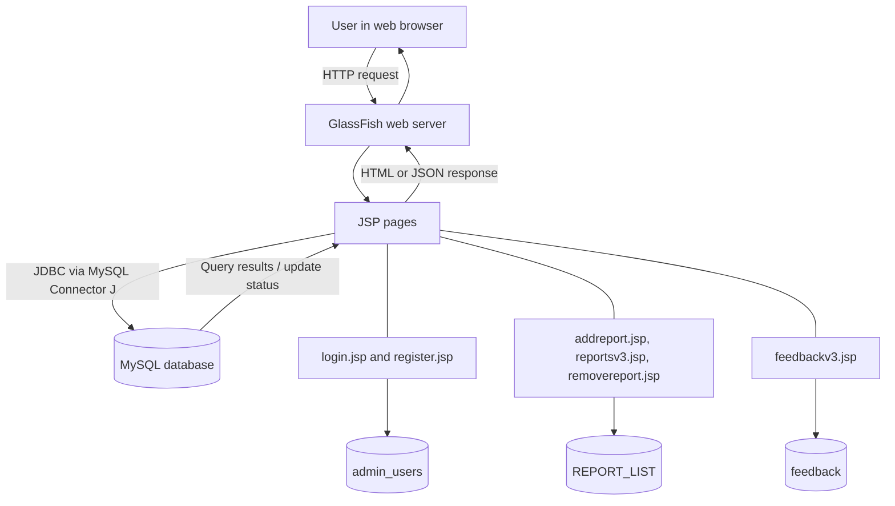

<div align="center">

# PSLV — JSP Basic CRUD Application

**A JSP web application for managing company reports and collecting feedback.**

Built with **NetBeans**, **GlassFish**, **JSP/JDBC**, and **MySQL**.

</div>


## About the project

The application provides an admin registration and login flow, report listing and CRUD operations, and a feedback form. JSP pages connect to MySQL through JDBC.

### Features

- Register and log in as an admin
- Add, list, and remove report records
- Submit feedback
- View a responsive interface styled with CSS

## Application screenshots

| Home | Reports |
|:---:|:---:|
|  |  |

| Feedback |
|:---:|
|  |

## Architecture and project flow



The browser sends requests to GlassFish, which executes the relevant JSP page. That page uses the MySQL Connector/J JDBC driver to read or update MySQL, then returns a response to the browser.

## Requirements

- JDK version supported by your NetBeans and GlassFish versions
- Apache NetBeans with Java Web support
- GlassFish Server registered in NetBeans
- MySQL Server and the MySQL command-line client
- MySQL Connector/J JDBC driver

## Run locally

### 1. Clone the repository

Replace the placeholder with this repository's HTTPS or SSH clone URL:

```bash
git clone <YOUR_GITHUB_REPOSITORY_URL>
cd JSP-based-Basic-Crud-Proj
```

### 2. Create the database and tables

Start MySQL, connect using the command-line client, and enter your MySQL password when prompted:

```bash
mysql -u root -p
```

Run this SQL in the MySQL prompt. These tables and columns match the queries used by the JSP pages:

```sql
CREATE DATABASE pslv_db;
USE pslv_db;

CREATE TABLE admin_users (
    id INT NOT NULL AUTO_INCREMENT,
    username VARCHAR(100) NOT NULL,
    password VARCHAR(255) NOT NULL,
    PRIMARY KEY (id),
    UNIQUE KEY uq_admin_users_username (username)
);

CREATE TABLE REPORT_LIST (
    ID VARCHAR(50) NOT NULL,
    TITLE VARCHAR(255) NOT NULL,
    AUTHOR VARCHAR(150) NOT NULL,
    PRIMARY KEY (ID)
);

CREATE TABLE feedback (
    id INT NOT NULL AUTO_INCREMENT,
    name VARCHAR(150) NOT NULL,
    company VARCHAR(150) NOT NULL,
    report TEXT NOT NULL,
    PRIMARY KEY (id)
);

SHOW TABLES;
```

Exit the MySQL prompt with `exit;`.

### 3. Configure the database connection

The JDBC URL, username, and password are currently hard-coded in these six JSP files:

- `addreport.jsp`
- `feedbackv3.jsp`
- `login.jsp`
- `register.jsp`
- `removereport.jsp`
- `reportsv3.jsp`

In each file, set the connection URL and credentials for your local MySQL instance. For the database created above:

```java
String dbUrl = "jdbc:mysql://localhost:3306/pslv_db";
String dbUser = "your_mysql_username";
String dbPass = "your_mysql_password";
```

The repository's current `root` / `password` values are placeholders; replace them. A dedicated MySQL account limited to this database is preferable to using `root`. Do not commit real credentials.

If using MySQL 5.5, update the driver class in these same JSP files as described in [Requirements](#requirements).

### 4. Add MySQL Connector/J to GlassFish

Download the Connector/J version appropriate for your MySQL server and Java version. Copy its JAR into the GlassFish domain library directory, for example:

```text
<GLASSFISH_HOME>/glassfish/domains/domain1/lib/
```

For MySQL 5.5, use Connector/J 5.1.49. For Connector/J 8.x, use a supported newer MySQL Server. Restart the GlassFish domain after adding the JAR.

<p align="center">
  
  <br>
  <em>NetBeans project setup with the web pages, JDBC driver library, JDK, and GlassFish server.</em>
</p>

### 5. Open and deploy the web application in NetBeans

This repository contains the web pages and `WEB-INF/glassfish-web.xml`, but does not include NetBeans project metadata (such as `nbproject`) or a build file. Create a NetBeans web project and add the repository files:

1. In NetBeans, select **File → New Project → Java Web → Web Application**.
2. Choose your installed GlassFish server and a Java/Jakarta EE version supported by it.
3. Copy the repository's JSP pages, `indexv3.html`, and `stylexv3.css` into the new project's **Web Pages** folder.
4. Copy `WEB-INF/glassfish-web.xml` into the new project's `Web Pages/WEB-INF` folder. It sets the context root to `/pca2final`.
5. Build and deploy/run the web project from NetBeans.

### 6. Open the application

With GlassFish running, visit the registration page to create the first admin account:

```text
http://localhost:8080/pca2final/register.jsp
```

Then sign in here:

```text
http://localhost:8080/pca2final/login.jsp
```

The default GlassFish HTTP port is `8080`. If your server uses a different port or you changed the context root, adjust the URL.

## Troubleshooting

| Problem | What to check |
|---|---|
| JDBC driver class not found | Confirm the Connector/J JAR is in the GlassFish domain `lib` directory and restart GlassFish. For MySQL 5.5, verify the `com.mysql.jdbc.Driver` class and Connector/J 5.1.49 are used. |
| Access denied or unknown database | Check the JDBC URL, username, and password in all six JSPs; make sure MySQL is running and the `pslv_db` tables exist. |
| Page not found | Confirm deployment succeeded, the context root is `/pca2final`, and the URL uses the correct GlassFish port. |
